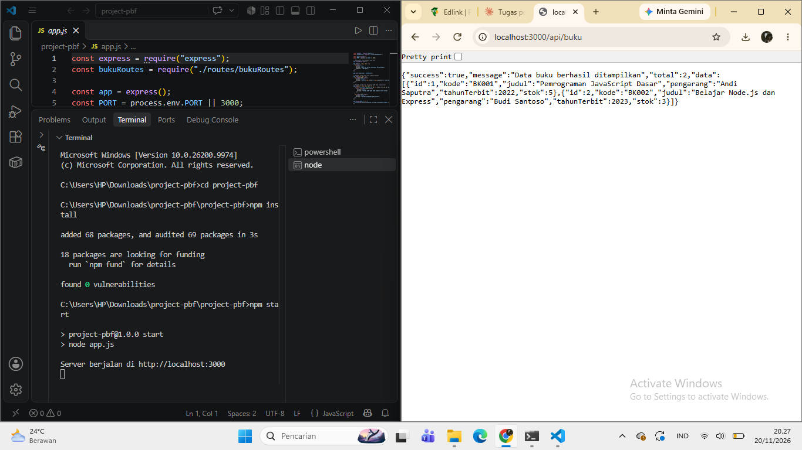
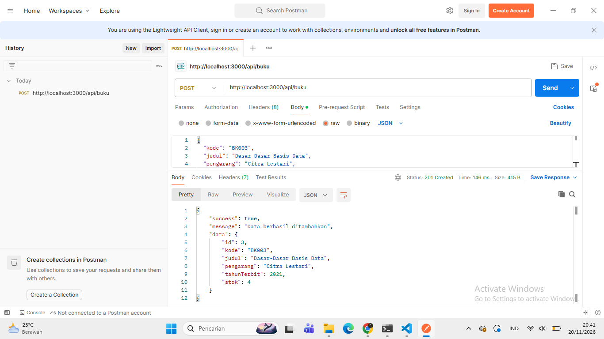
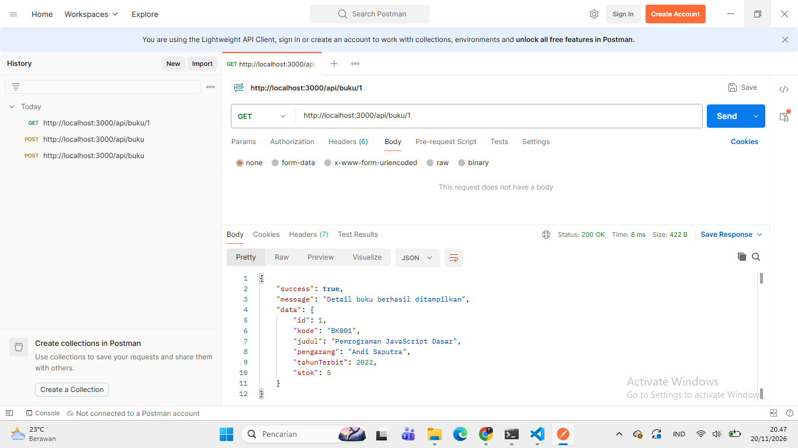
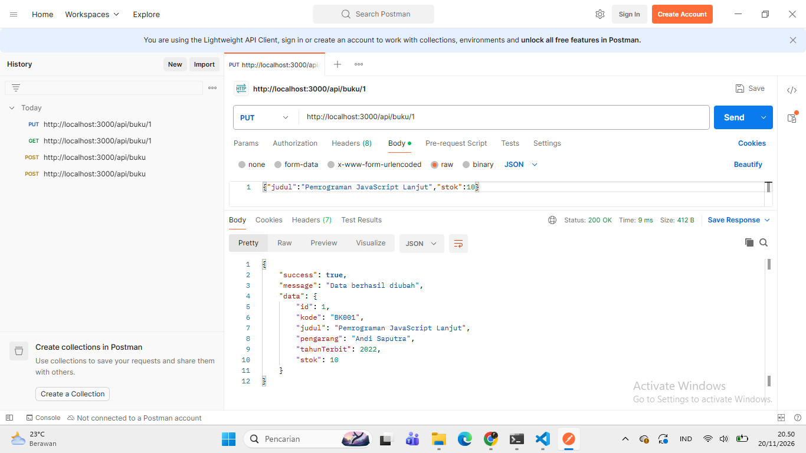
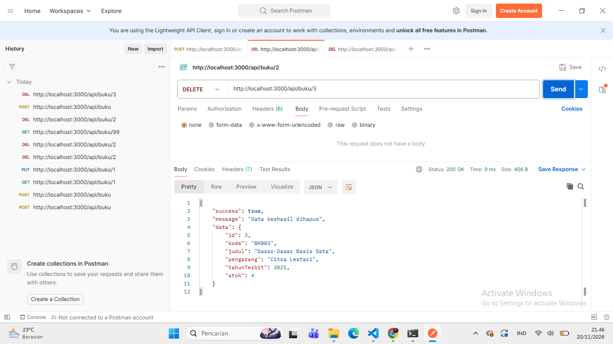
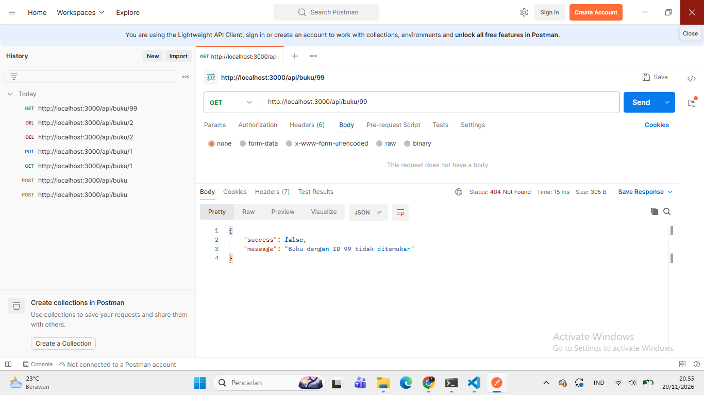

# REST API Sistem Informasi Perpustakaan

Tugas Project PBF Sesi 7: Pengembangan REST API menggunakan Node.js dan Express.js.
Data disimpan sementara dalam array (tanpa database), jadi data kembali ke kondisi awal setiap server di-restart.

## Struktur Project

```
project-pbf/
├── models/
│   └── bukuModel.js
├── controllers/
│   └── bukuController.js
├── routes/
│   └── bukuRoutes.js
├── app.js
└── package.json
```

## Cara Menjalankan

```bash
npm install
npm start
```

Server berjalan di `http://localhost:3000`.

## Daftar Endpoint

| Method | Endpoint        | Fungsi                  |
|--------|-----------------|-------------------------|
| GET    | /api/buku       | Menampilkan semua buku  |
| GET    | /api/buku/:id   | Menampilkan detail buku |
| POST   | /api/buku       | Menambahkan buku        |
| PUT    | /api/buku/:id   | Mengubah buku           |
| DELETE | /api/buku/:id   | Menghapus buku          |

## Struktur Data Buku

| Field       | Tipe   | Keterangan                     |
|-------------|--------|--------------------------------|
| id          | number | Dibuat otomatis oleh server    |
| kode        | string | Kode buku, harus unik          |
| judul       | string | Judul buku                     |
| pengarang   | string | Nama pengarang                 |
| tahunTerbit | number | Tahun terbit                   |
| stok        | number | Jumlah stok buku               |

## Detail Endpoint

### 1. GET /api/buku

Menampilkan seluruh data buku.

Response `200 OK`:

```json
{
  "success": true,
  "message": "Data buku berhasil ditampilkan",
  "total": 2,
  "data": [
    {
      "id": 1,
      "kode": "BK001",
      "judul": "Pemrograman JavaScript Dasar",
      "pengarang": "Andi Saputra",
      "tahunTerbit": 2022,
      "stok": 5
    },
    {
      "id": 2,
      "kode": "BK002",
      "judul": "Belajar Node.js dan Express",
      "pengarang": "Budi Santoso",
      "tahunTerbit": 2023,
      "stok": 3
    }
  ]
}
```

### 2. GET /api/buku/:id

Menampilkan detail buku berdasarkan ID.

Response `200 OK` (contoh `/api/buku/1`):

```json
{
  "success": true,
  "message": "Detail buku berhasil ditampilkan",
  "data": {
    "id": 1,
    "kode": "BK001",
    "judul": "Pemrograman JavaScript Dasar",
    "pengarang": "Andi Saputra",
    "tahunTerbit": 2022,
    "stok": 5
  }
}
```

Response `404 Not Found` (contoh `/api/buku/99`):

```json
{
  "success": false,
  "message": "Buku dengan ID 99 tidak ditemukan"
}
```

### 3. POST /api/buku

Menambahkan buku baru. Semua field wajib diisi.

Request body:

```json
{
  "kode": "BK003",
  "judul": "Dasar-Dasar Basis Data",
  "pengarang": "Citra Lestari",
  "tahunTerbit": 2021,
  "stok": 4
}
```

Response `201 Created`:

```json
{
  "success": true,
  "message": "Data berhasil ditambahkan",
  "data": {
    "id": 3,
    "kode": "BK003",
    "judul": "Dasar-Dasar Basis Data",
    "pengarang": "Citra Lestari",
    "tahunTerbit": 2021,
    "stok": 4
  }
}
```

Response error:

- `400 Bad Request` jika ada field yang kosong
- `409 Conflict` jika kode buku sudah dipakai

### 4. PUT /api/buku/:id

Mengubah data buku berdasarkan ID. Field yang tidak dikirim tetap memakai nilai lama.

Request body (contoh `/api/buku/1`):

```json
{
  "judul": "Pemrograman JavaScript Lanjut",
  "stok": 10
}
```

Response `200 OK`:

```json
{
  "success": true,
  "message": "Data berhasil diubah",
  "data": {
    "id": 1,
    "kode": "BK001",
    "judul": "Pemrograman JavaScript Lanjut",
    "pengarang": "Andi Saputra",
    "tahunTerbit": 2022,
    "stok": 10
  }
}
```

Response `404 Not Found` jika ID tidak ada:

```json
{
  "success": false,
  "message": "Buku dengan ID 99 tidak ditemukan"
}
```

### 5. DELETE /api/buku/:id

Menghapus buku berdasarkan ID.

Response `200 OK` (contoh `/api/buku/3`):

```json
{
  "success": true,
  "message": "Data berhasil dihapus",
  "data": {
    "id": 3,
    "kode": "BK002",
    "judul": "Belajar Node.js dan Express",
    "pengarang": "Budi Santoso",
    "tahunTerbit": 2023,
    "stok": 3
  }
}
```

Response `404 Not Found` jika ID tidak ada:

```json
{
  "success": false,
  "message": "Buku dengan ID 99 tidak ditemukan"
}
```

## Pengujian dengan Postman

Urutan pengujian yang disarankan (sesuai ketentuan tugas):

1. `GET /api/buku` untuk menampilkan data
2. `POST /api/buku` untuk menambahkan data
3. `GET /api/buku/1` untuk menampilkan detail berdasarkan ID
4. `PUT /api/buku/1` untuk memperbarui data
5. `DELETE /api/buku/1` untuk menghapus data
6. `GET /api/buku/99` untuk membuktikan pesan ketika data tidak ditemukan

Di Postman, untuk request POST dan PUT pilih tab **Body**, pilih **raw**, ubah tipe ke **JSON**, lalu isi body seperti contoh di atas.

## Hasil Pengujian

Pengujian dilakukan menggunakan Postman (Lightweight API Client) dan browser.

### 1. Menampilkan semua data (GET /api/buku)
Status 200 OK, data buku berhasil ditampilkan.



### 2. Menambahkan data (POST /api/buku)
Status 201 Created, data baru mendapat id otomatis.



### 3. Detail data berdasarkan ID (GET /api/buku/1)
Status 200 OK, data buku dengan id 1 ditampilkan.



### 4. Memperbarui data (PUT /api/buku/1)
Status 200 OK, judul dan stok berubah, field lain tetap.



### 5. Menghapus data (DELETE /api/buku/2)
Status 200 OK, data yang dihapus dikembalikan pada response.



### 6. Data tidak ditemukan (GET /api/buku/99)
Status 404 Not Found dengan pesan "Buku dengan ID 99 tidak ditemukan".


